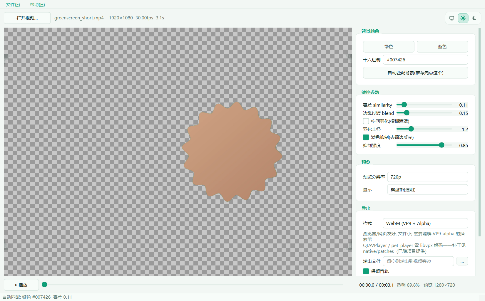

# ChromaKey Studio

绿幕 / 蓝幕视频抠像，导出**带 Alpha 通道**的视频。Windows 本地运行，不需要显卡，不联网。

界面是 C++ / Qt6 写的，编解码静态链接 FFmpeg——**便携包 43 MB，解压即用，不需要安装任何运行库**。



## 下载

到 [Releases](https://github.com/delaolao/chromaKeyStudio/releases) 下载
`ChromaKeyStudio-<版本>-win64-portable.zip`，解压后双击 `ChromaKeyStudio.exe`。

要求：Windows 10 / 11 x64。

## 功能

- 导入 H.264 / H.265 的 mp4 / mov / mkv / avi，实时预览抠像效果（720p 预览约 19 ms/帧）
- 自动匹配背景色与容差，多数素材点一下就能用
- 容差 / 边缘过渡 / 空间羽化 / 溢色抑制 四个参数实时可调
- 导出四种带 Alpha 的格式（见下表）
- 拖动时间轴可看任意一帧；空格播放 / 停止
- 界面配色跟随系统亮暗

## 输出格式

| 格式 | 1080p 3 秒参考体积 | Alpha 存法 | 适用 |
|---|---|---|---|
| **MOV + PNG (RGBA)** | 8.0 MB | 单流内建 | 桌面播放器最稳 |
| **MOV + QuickTime RGBA**（qtrle） | 15.0 MB | 单流内建 | 实拍类素材体积通常更小 |
| **ProRes 4444** | 17.2 MB | 单流内建 | 剪辑软件 / 调色 |
| **WebM (VP9 + Alpha)** | 0.29 MB | 单流 + BlockAdditional | 浏览器、网页 |

**不支持 MP4 / H.264 输出**——这类格式的规范里没有 Alpha 通道。

导出前会跑一道**门禁**：重新打开输出文件，确认容器标记 / 像素格式里真的有 alpha，
并统计透明像素占比；不通过就报错，不会悄悄输出一个不透明的文件。

### 关于 WebM 的 Alpha

FFmpeg 把 VP9 的 alpha 写在**同一路视频流**的 BlockAdditional 旁路里，并在容器上打
`AlphaMode=1`。FFmpeg 自带的 `vp9` 解码器**不还原**这份数据，所以很多播放器（包括
QtAVPlayer 系）会把它当成不透明。

- 浏览器（Chrome / Edge / Firefox）能正常显示；
- 桌面播放器需要支持 `libvpx` 解码。QtAVPlayer / pet_player 的补丁见
  [`patches/qtavplayer-alpha-webm.patch`](patches/qtavplayer-alpha-webm.patch)
  （说明见 [`patches/PR-说明.md`](patches/PR-说明.md)），打上之后单流 WebM 也能直接透明播放。

## 键控算法

不是色度键的简单阈值，而是三步：

1. **亮度归一化色度距离**：`nd[c] = c / max(luma, 64) * 64`，再算与键色的距离。
   除以亮度让暗部不会因为整体变暗而误判。
2. **溢色覆盖率**：`excess = main - max(另外两个通道)`，用它把边缘的半透明像素压掉，
   同时做 despill（`main -= excess * mix`），去掉发丝上的绿反光。
3. **透明区填黑**：完全透明的像素写成黑色而不是原来那层绿色。
   有损编码会在绿色背景上留下噪点，填黑之后即使播放器忽略 alpha，看到的也是干净的黑色。

三条都做了 C++ 实现（SSE2 由编译器自动向量化），与参考用的 Python 实现逐像素对拍：

```
plain  : alpha 平均差 0.000   最大 0    差>2 的像素 0.000%
feather: alpha 平均差 0.004   最大 1    差>2 的像素 0.000%
wide   : alpha 平均差 0.000   最大 13   差>2 的像素 0.001%
```

## 从源码构建

### 依赖

- Qt 6（Core / Gui / Widgets）
- MinGW 13 或任意 C++17 编译器
- CMake ≥ 3.20、Ninja
- 静态库：FFmpeg 7.x（自编，见下）、libvpx、libopus、zlib

### 自编最小 FFmpeg

便携包里的 FFmpeg 是裁过的：只留用到的解码器、编码器和封装格式，
静态库合计约 13 MB（完整构建是 200 MB+）。

```bash
./configure --disable-everything --disable-programs --enable-gpl \
  --enable-libvpx --enable-libopus --enable-zlib \
  --enable-decoder=h264,hevc,prores,qtrle,png,vp9,libvpx_vp9,rawvideo,aac,opus,mp3,flac,pcm_s16le,pcm_s24le \
  --enable-encoder=libvpx_vp9,prores_ks,qtrle,png,libopus,pcm_s24le,aac \
  --enable-muxer=webm,mov --enable-demuxer=mov,matroska,rawvideo \
  --enable-swscale --enable-swresample
```

### 编译

```bash
cmake -S . -B build -G Ninja -DCMAKE_BUILD_TYPE=Release \
  -DCMAKE_PREFIX_PATH=/path/to/Qt/6.x.x/mingw_64
cmake --build build
```

产物：`build/ChromaKeyStudio.exe`（约 9.3 MB，含静态 FFmpeg）、`build/ckcli.exe`（无界面导出）。

### 打包便携版

```bash
cp build/ChromaKeyStudio.exe portable/
windeployqt --release --no-translations --no-opengl-sw portable/ChromaKeyStudio.exe
# 删掉用不到的（省 26 MB）
rm portable/dxcompiler.dll portable/dxil.dll portable/Qt6Svg.dll portable/Qt6Network.dll
rm -r portable/tls portable/networkinformation portable/iconengines portable/generic
```

## 自检

换机器后可以先跑一遍全链路自检（解码 → 键控 → 四种格式导出 → Alpha 门禁）：

```powershell
ChromaKeyStudio.exe --selftest 某个视频.mp4
type selftest.log
```

## 目录

```
src/core/      键控数学、FFmpeg 封装、导出管线
src/ui/        主窗口、预览控件、配色、关于对话框
tests/         与 Python 参考实现的对拍程序、无界面导出工具
patches/       QtAVPlayer 的 WebM alpha 补丁
```

## 开源协议

**GPL-3.0**，全文见 [LICENSE](LICENSE)。

本程序通过 FFmpeg 的 `--enable-gpl` 构建（ProRes 编码器属于 GPL 部分），
整体按 GPL-3.0 分发。随附组件：

| 组件 | 协议 |
|---|---|
| Qt 6 | LGPL-3.0 |
| FFmpeg | GPL-3.0（`--enable-gpl`） |
| libvpx | BSD-3-Clause |
| libopus | BSD-3-Clause |
| zlib | zlib License |
